# If I Disappear

**Leaving home for months? Find what stops before you go.**

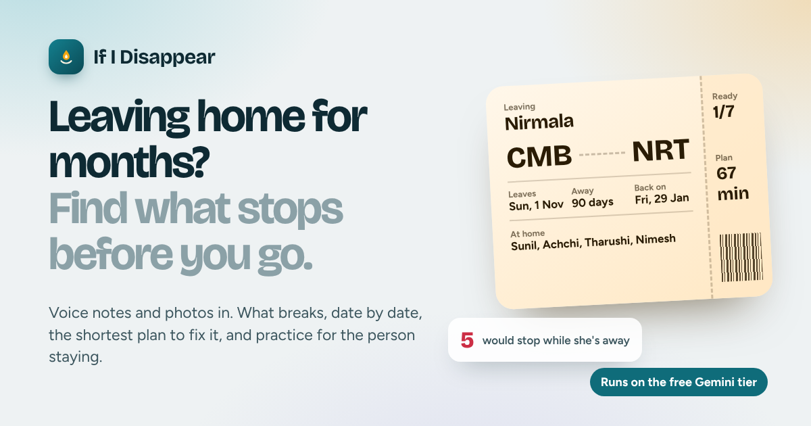

> **📦 Full project download.** If anything in this repository doesn't work or looks
> incomplete (the GitHub website can't upload hidden files such as `.gitignore` and `.github/`),
> download **[if-i-disappear-full-project.zip](if-i-disappear-full-project.zip)** from this
> repository. It contains the complete project, every file including the hidden ones, the same
> code that runs on the live app. Unzip it and follow [HOW_TO_RUN.md](HOW_TO_RUN.md) to run it, or
> [DEPLOY_SIMPLE.md](DEPLOY_SIMPLE.md) to deploy it. The submission deck is in
> [docs/](docs/ZNeurons_IfIDisappear_AIBuilderCup.pdf).

Built by **Team Z Neurons** (Sri Lanka) for the **Google Cloud AI Builder Cup 2026**,
theme *Sustainability and Social Impact*, with Gemini, Gemma, Gemini Live, the Agent
Development Kit and Google Cloud Run.

---

## The night before

It's 11 at night in Kurunegala. The suitcase is packed and standing by the door.

Tomorrow morning Nirmala leaves for a caregiving job in Japan. She'll be gone for ninety days.
She has done the sensible things: the money is arranged, the relatives have been told, the
children have promised to be good. Her husband Sunil says, *"Don't worry. We'll manage."*

But Nirmala is the house's memory. She is the one who knows that the electricity bill comes on
paper and has to be paid by the 10th. That the school only sends messages to *her* number, and
her SIM is going with her. That the van driver's number lives only on her phone. That her
mother's clinic book is in the second drawer, the one nobody else opens. That the vehicle
insurance runs out in the middle of her time away. That clinic day is Thursday morning, which
is exactly when Sunil drives his airport runs.

None of this is written down anywhere. Nobody thinks to ask, because nobody knows it matters,
until three weeks later, when a clinic visit is missed, a school notice never arrives, and a
policy quietly lapses.

**Nothing went wrong on the day she left. Everything went wrong because of what nobody said.**

This is not one family's story. In 2024 a record **312,836 Sri Lankans** left home to work
abroad, and **2.19 million Filipinos** worked overseas, 57% of them women ([sources](docs/RESEARCH.md)).
In 2025 Sri Lanka's workers abroad sent home **USD 8.07 billion**. Behind every one of those
departures is a household that has to keep running on knowledge that just got on a plane. The
same thing happens, every day, when someone goes into hospital for weeks.

**If I Disappear exists for the night before**: the last moment when there is still time to
find what will break, and fix it.

---

## What it is

If I Disappear is an AI app for the people who hold a household together, and the people who
take over from them.

Before someone leaves home for weeks or months, it **listens to how the house really runs**,
finds **what only that person knows or holds**, shows **what will stop, on which date, and
why**, and turns it into the **smallest plan the family can actually do**. Then the person
staying **practises the handover out loud** with a Gemini Live partner, until they can explain
each task without help.

| Light | Dark |
|---|---|
| 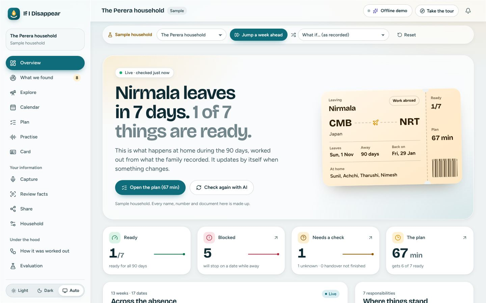 | 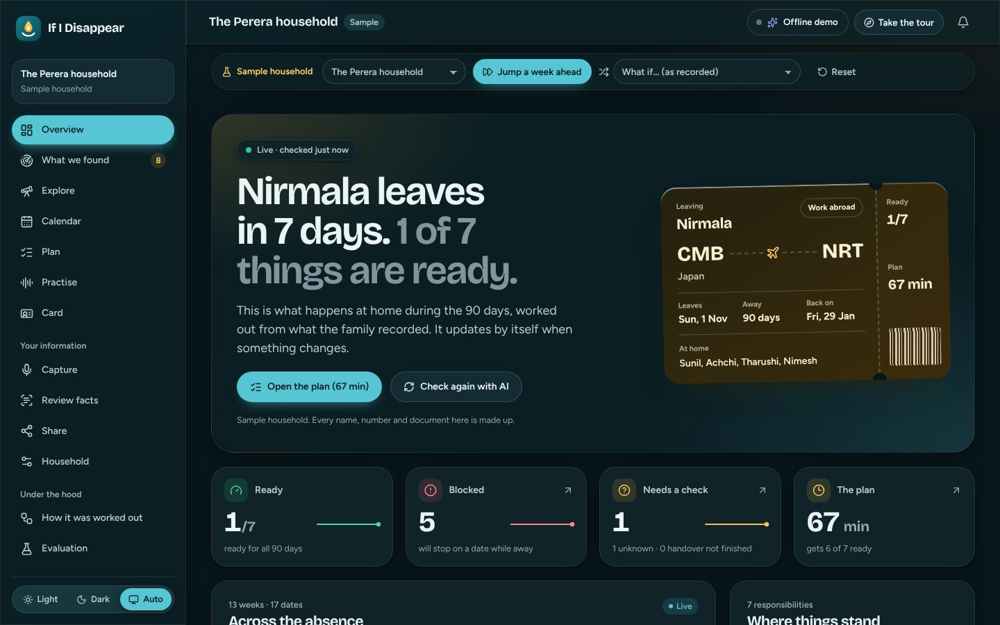 |

*The Perera sample household a week before Nirmala leaves: only **1 of 7** things are ready.
The plan gets **6 of 7** ready in **67 minutes**.*

---

## How it works, in eight steps

The app follows the family's own path. Each step is a screen.

| | Step | What happens |
|---|---|---|
| 1 | **Capture** | The family talks (voice notes), takes photos of bills and notices, uploads PDFs, types notes, or fills a short form with no AI at all. PINs, passwords and card numbers are removed before anything is stored or sent. |
| 2 | **Check the facts** | Gemini turns each source into small facts, and **each fact quotes the exact words it came from**. Code checks every quote word for word. Nothing is used until a person accepts it. |
| 3 | **See what stops** | A deterministic engine walks through **every day of the absence**: who would do each task, by which route, with what, in which time window. Each task gets a state, a date and a reason a person can act on. |
| 4 | **Find what nobody said** | Seven kinds of findings: still needed while away, held only by the person leaving, schedule clashes, deadlines mid-absence, people nobody asked, sources that disagree. A **knockout test** sets false alarms aside, and shows them. |
| 5 | **Try what-ifs** | "What if Sunil is away too? What if the phone isn't there?" Recomputed instantly, with no AI and nothing saved. |
| 6 | **Plan** | The fewest steps that get the most ready in the time the family has, found by an exhaustive search, and honest about what stays open. |
| 7 | **Practise** | The person staying explains the task back, by voice with a **Gemini Live** partner or by typing. A step only counts if they said it. |
| 8 | **Hand over** | A one-page **Continuity Card** for the fridge (never with a PIN or password), and a private link for each person staying, on their own phone. |

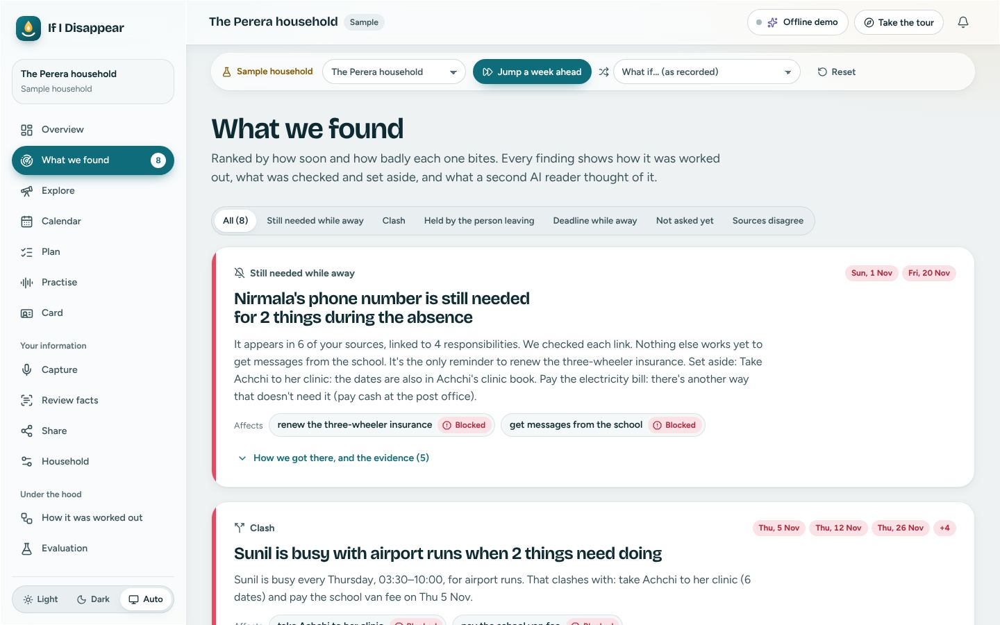

---

## The rule that makes it trustworthy: the AI reads, code decides

Language models are wonderful at listening to a rambling voice note and terrible at being a
source of truth. So in this app they never are.

- **Every fact quotes its source, word for word.** A misquote is rejected and shown next to the
  passage it probably meant.
- **People accept facts.** Nothing a model says reaches the engine until a person accepts it,
  even text written to manipulate the model.
- **Every number comes from code**: readiness, dates, findings, plan minutes, grades. A Gemini
  reviewer can uphold a finding, narrow it with evidence, or turn it into a question. It can't
  add one or change a number.
- **Unknown stays unknown.** Three-valued logic means a missing fact becomes a question, never a
  silent "no".
- **Same facts, same answer.** The engine is deterministic; shuffled input gives identical output.

---

## Google AI and Google Cloud

| | Used for |
|---|---|
| **Gemini 3.8 Flash** | First choice for the hardest steps: voice notes, photos, fact extraction and the AI review, with structured output |
| **Gemini 3.5 and 3.1 Flash-Lite** | The everyday workhorses on the free tier: the same jobs when Flash is busy, and grading practice |
| **Gemma 4 31B** | The last resort for text and images, with a large daily allowance; its answers are still validated |
| **Gemini 3.8 Live** | The spoken practice partner, through single-use ephemeral tokens, so the API key never reaches the phone |
| **Agent Development Kit** | Every model call runs inside a workflow graph of code nodes, agent nodes and guards. The **How it was worked out** page shows each step and model. |
| **Cloud Run** | One container: the API and the web app, on one HTTPS URL (asia-south1) |
| **Firestore** | One document per household, written in transactions; the free-tier ledger survives restarts |
| **Cloud Storage** | Private uploads, deleted after 30 days |
| **Secret Manager, Cloud Build, Artifact Registry** | Keys, builds and images (`infra/`) |

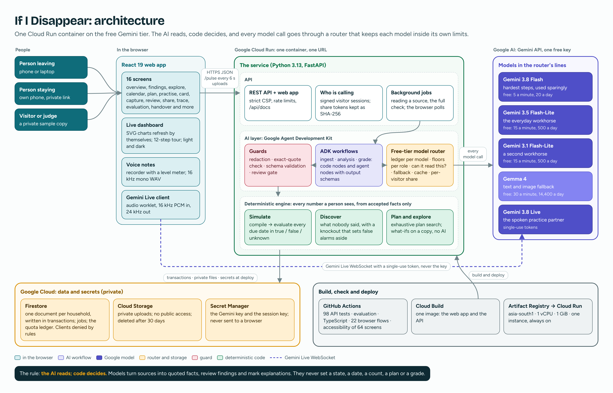

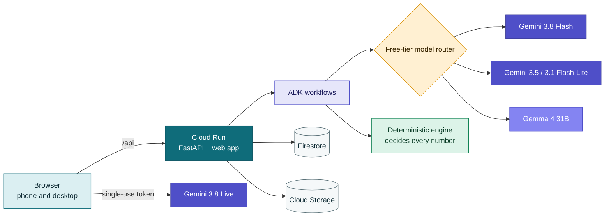

### The system, end to end

Twelve stages, from a voice note to a plan the family can practise: the hardened edge, the
three ADK workflow graphs, the five-model free-tier router, the human review gate, and the
deterministic engine that decides every number. *Click the image to open it full size.*

[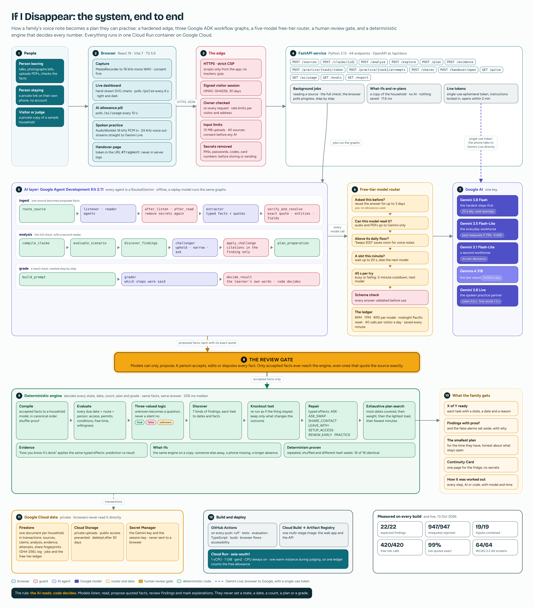](docs/diagrams/19-system-deep-dive.png)

### Built to run on one free Gemini key

The families who need this most can't pay for an AI subscription. So a **model router** turns
a handful of small free allowances into an app that keeps working all day:

- every AI job has its own line of models, best first;
- a ledger tracks each model's requests per minute, tokens per minute and requests per day,
  and keeps a floor of allowance so a busy day of photos never leaves a voice note unheard;
- only models that can read the input are tried; a busy model falls through to the next;
  every answer is checked against its schema; identical requests reuse the first answer;
- the top bar shows today's allowance per model, live, and every step says which model answered.

In a simulated judging day on one free key, **420 of 420** AI calls were answered (one model
alone: 19). Details: [docs/FREE_TIER.md](docs/FREE_TIER.md).

---

## Measured, not claimed

Every number below comes from the evaluation harness, the test suites, or the live run with a
free Gemini key on 13 October 2026 ([evals/reports/latest.md](evals/reports/latest.md), also shown at `/evals` in the app).
The benchmark is four hand-written synthetic households: three migrations and a hospital stay,
with 21 responsibilities and 201 facts.

| | Result |
|---|---|
| Expected findings found, with no extra findings | **22 of 22** |
| Readiness states; first-problem dates | **28 of 28**; 15 of 15 |
| Links that really matter: association alone vs with the knockout test | 57% vs **100%** |
| Misquotes rejected; harmless formatting still accepted | **947 of 947**; 295 of 295 |
| Secrets removed; hijacked-model outputs contained | 16 of 16; **19 of 19** |
| Same facts, same answer (repeated, shuffled, different hash seeds) | 16 of 16 |
| A simulated day on the free tier: judging day, busy day, rush | 420/420, 2800/2800, 210/210 |
| Engine time per household | 206 ms median, 676 ms slowest |
| Tests; browser flows; accessibility (axe-core, WCAG 2.2 AA) | 98 of 98; 22 of 22; 64 of 64 screens |
| Lighthouse performance, phone / desktop | 90 to 94 / 97 to 100 |
| **Live:** quotes Gemini extracted that are found word for word | **99%** (179 of 181) |
| **Live:** extraction precision and recall against hand-written facts | 75% and 67% |
| **Live:** findings right if nobody reviewed anything (the worst case) | 6 of 22, which is why every fact waits for a person |
| **Live:** every AI path; real-browser flows, Gemini Live included | 13 of 13; 9 of 9 |

The benchmark earned its keep: its first runs caught real engine bugs, which were fixed in the
engine without touching the expected answers ([details](docs/EVALUATION.md)).

---

## Try it

**On the web:** open the [live app](https://if-i-disappear-4bxcm67cia-el.a.run.app) and choose
**See a family's plan**. A short tour starts by itself. Every visitor gets a private copy of the
sample family, and **Reset** puts it back. Then try **Jump a week ahead**: 1 of 7 becomes 6 of 7,
as the plan predicted.

**On your computer** (no key needed for the offline demo):

```bash
make setup   # Python venv + web app dependencies (Python 3.12+, Node 22)
make serve   # builds the web app and serves everything on http://localhost:8080
```

Add a Gemini key in `services/api/.env` to turn on live AI (a free key from Google AI Studio
works). Deploying to Google Cloud takes two commands (`bash infra/setup.sh`, then
`bash infra/deploy.sh`). The simple, step-by-step way, from your browser: **[DEPLOY_SIMPLE.md](DEPLOY_SIMPLE.md)**.
Everything else: **[HOW_TO_RUN.md](HOW_TO_RUN.md)**.

| | | |
|---|---|---|
| 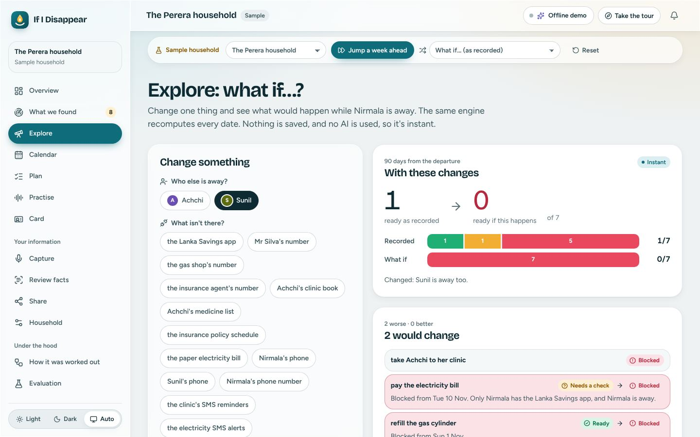 | 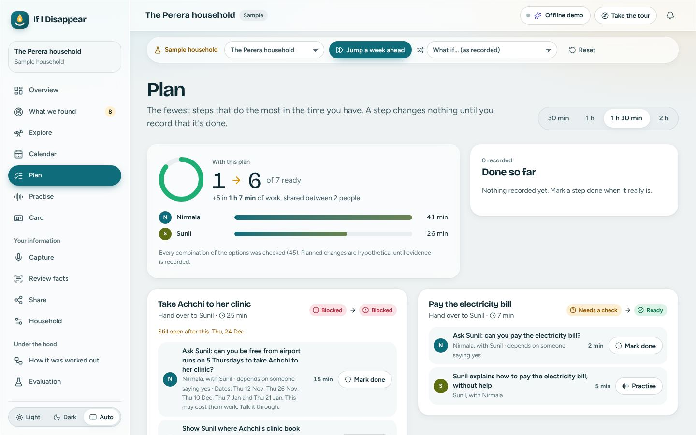 | 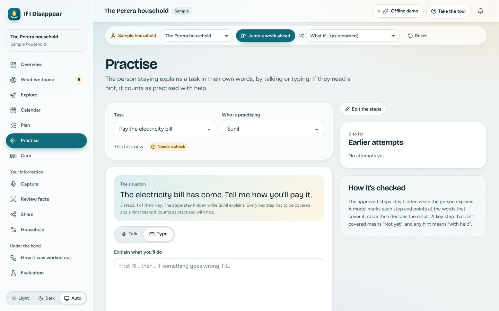 |
| **Explore**: what if Sunil is away too? | **Plan**: 67 minutes gets 6 of 7 ready | **Practise**: explain it back, by voice or typing |
| 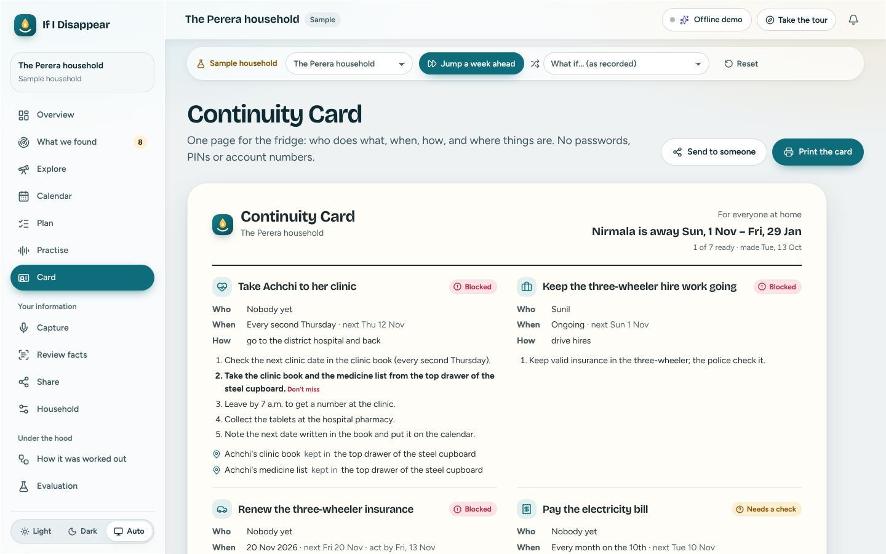 | 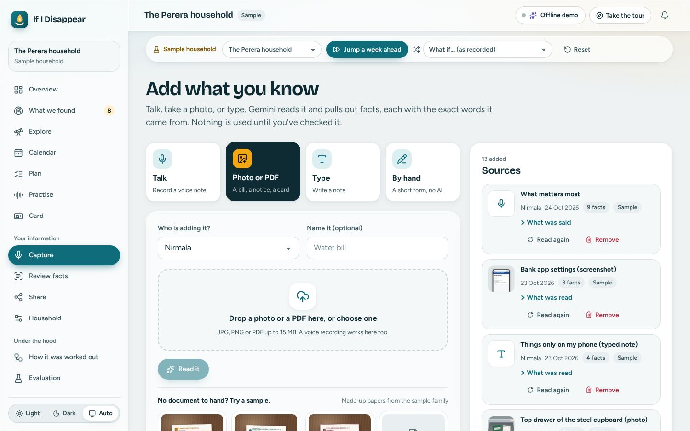 | 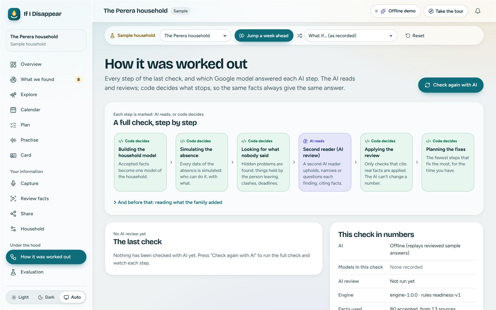 |
| **Card**: one page, no secrets | **Capture**: talk, photo, type or by hand | **Under the hood**: AI reads, code decides |

### The sample households

| Household | Story |
|---|---|
| **Perera**, Kurunegala | Nirmala leaves for a caregiving job in Japan for 90 days. The main demo, with a "week later" stage and what-if variants. |
| **Selvarajah**, Jaffna | Selvam leaves for Qatar for 120 days; Malar's factory shift clashes with the children's tuition. |
| **Dela Cruz**, Batangas | Liza leaves for Hong Kong; bill reminders only reach her email; Ramon's ID expires mid-absence. |
| **Jayasinghe**, Colombo | Dilini goes into hospital for two weeks; her brother has to get their father to dialysis. |

All names, numbers and documents are made up and marked as samples.

---

## Privacy and safety

No secrets are ever stored: the app records that a PIN *exists*, never the PIN. Phone numbers
keep only their last four digits. Uploads are private and deleted after 30 days. A household
can be exported or deleted in full. Handover links store only a SHA-256 fingerprint and can be
switched off at any time. The model can never approve its own facts. On the free tier Google may
use what it is sent to improve its products, so the app asks before sending anything, and
recommends a paid key for real households. See [docs/PRIVACY_AND_SAFETY.md](docs/PRIVACY_AND_SAFETY.md)
and [SECURITY.md](SECURITY.md).

---

## This is a prototype

If I Disappear works end to end today, live on Google Cloud. But it is a **prototype**: the
first, carefully tested slice of a much bigger idea. We are honest about what it is not yet:

- It has been tested with **synthetic households**, written by the team, not with real
  families. A consented pilot is the next step.
- The live Gemini paths were tested on one day with a free key, in a desktop browser. Testing on
  low-cost Android phones and slow networks is still to come.
- Extraction finds about two thirds of the facts a careful person writes down. The design
  assumes this: every fact quotes its source, people accept facts, and anything missed can be
  added by hand.
- The interface is in **English only** for now.
- The free-tier limits are the ones Google published at the time of writing; they are
  settings, not code.

---

## Future development

We will keep building. Here is what comes next, from the next three months to the next few
years.

### 1. Easier for everyone to use

The people who need this most are often tired, worried, reading in a second language, using an
old phone, or not used to apps at all. Making it effortless for them is our first priority.

- **Simple mode:** fewer words, bigger buttons, one task per screen, and clear icons for
  families who find reading hard.
- **Voice first, everywhere:** move through the whole app by talking, not only in practice:
  "What do I need to do this week?"
- **Large text and high-contrast themes**, beyond today's WCAG 2.2 AA, with comfortable
  one-handed use on small phones.
- **An elder-friendly mode** for grandparents who take over tasks: slower, louder, larger,
  calmer.
- **Sinhala and Tamil first, then Filipino and more**, with native speakers reviewing every
  screen, prompt and practice; and support for the way people really talk, mixing languages in
  one sentence.
- **Works on a weak connection:** an installable app that keeps the card, the plan and practice
  available offline, and syncs when it can.
- **Guided first visit:** a friendly helper that sets up the household by asking a few spoken
  questions, instead of forms.

### 2. More useful for families

- **Reminders that reach the person staying**, on their own phone, so nothing depends on the
  leaver's number.
- **Ask the house:** questions in plain language ("What do I need for the clinic on Thursday?")
  answered only from accepted facts, with their quotes, and "I don't know" when the facts don't say.
- **Living continuity:** a two-minute voice check-in each month keeps the facts fresh. Gemini
  listens for changes ("the clinic moved to Fridays") and the engine re-runs the absence, so a
  family hears about a problem before it happens.
- **Practice at the right moment:** a short spoken refresher the week before a rare task is due,
  like an annual renewal.
- **A coach that can see:** Gemini Live with the camera ("show me the gas regulator") for tasks
  that are easier shown than described.
- **More than one absence at a time**, roles for the whole family, and a shared view for
  relatives abroad.
- **Private by default, on the phone:** small on-device models (Gemma) remove secrets and do a
  first reading before anything leaves the phone.

### 3. Beyond one family

- **Pre-departure programmes:** migrant workers' bureaus, recruitment agencies and NGOs use it in
  orientation, so every worker leaves with a household plan as well as a contract.
- **Hospitals and discharge planning:** the same check before a planned surgery or a long stay.
- **Banks, schools, clinics and telecoms:** the findings name what institutions could fix
  ("only one registered number"). With consent, an institution could confirm a fact directly.
- **Small businesses and care teams:** the shop when the owner travels, the family business,
  the care team at shift change.
- **Disasters and disruption:** "What stops if the road floods, or the power is out for a week?"
  is the same simulation with something different removed.
- **An open handover standard:** the Continuity Card as a small, open, machine-readable format
  that other apps and institutions can read and write, with no secrets in it.

### 4. Research we want to do

The prototype raises questions we want to answer properly, with real evidence. Each idea below
says what we'd ask, why it matters, and how we'd find out.

| Research idea | The question | How we would study it |
|---|---|---|
| **Hidden single points of failure** | What breaks most often when one person leaves a household, and how early can it be predicted? | A consented, anonymised field study with partner organisations: compare what the app predicted before departure with what actually went wrong in the first month. |
| **People and AI, together** | How much review effort gives the best facts? When should the app ask a person, and when can it wait? | Compare accuracy and family effort across review designs: accept-all, review-every-fact, and review-only-uncertain facts. |
| **Causal checks for real life** | Does the knockout test (re-running the absence without each link) keep finding the links that truly matter in messy real households? | Grow the benchmark with real, anonymised cases; measure precision and recall of flagged links against what families confirm. |
| **Learning by explaining** | Does spoken practice with an AI partner help people remember a task weeks later, compared with reading instructions? | A small study: one group practises by voice, one reads the card; test recall and real task success after two and six weeks. |
| **Understanding mixed-language speech** | How well can the models extract facts from voice notes that mix Sinhala or Tamil with English? | Build an evaluation set of consented, de-identified voice notes; measure quote accuracy, precision and recall per language mix. |
| **Accessible design for low literacy** | Which interface choices help people with low literacy, low vision or little app experience complete a plan? | Co-design sessions and usability tests with families, elders and caregivers; measure task completion and confidence. |
| **Privacy-preserving insights** | Can we learn which institutional rules cause the most breakdowns without exposing any household? | Aggregate only consented, anonymised patterns with differential-privacy techniques; publish findings for policy makers. |
| **On-device redaction** | Can a small on-device model reliably remove secrets before anything leaves the phone? | Compare small on-device models with today's rules on a growing redaction set; measure what is caught and what slips through. |
| **Smart use of free AI** | How can a router get the best quality from several free model allowances at the lowest cost? | Treat routing as an optimisation problem; test new policies in the router simulation, then live. |
| **A verified engine** | Can we prove the engine's key promises, like "unknown never becomes no", always hold? | Property-based testing and formal checks on the engine's rules, added to the evaluation harness. |

### Roadmap

| When | What | How we'll know it worked |
|---|---|---|
| **Now** (built) | Capture, quoted facts, review, the simulation, findings with the knockout test, the AI reviewer, what-ifs, the plan, evidence, practice by voice and typing, the card and private links, the free-tier router, the evaluation harness, live on Cloud Run | 98 tests, 22 flows, 64 accessibility checks and the live run, all passing |
| **Next 3 months** | Real phones, simple mode and voice-first navigation, Sinhala and Tamil, a consented pilot with 50 to 200 families, reminders, offline use, "ask the house" | Readiness before departure; findings families say they'd have missed; how easy families find it |
| **6 to 12 months** | Living continuity, practice before rare tasks, the camera coach, on-device redaction, more languages, more than one absence | Readiness that stays high during the absence; fewer missed payments and appointments |
| **2 to 3 years** | Pre-departure programmes, hospitals, banks, schools; small organisations; disaster preparedness; the open handover standard; research published | Institutions that change a single-contact rule because of the evidence; families reached through partners |

Families should never pay to keep their household running. A household costs about $0.34 to
$0.58 of AI on a paid key, little enough for the organisations that already serve these families
to fund. More: [docs/ROADMAP.md](docs/ROADMAP.md) and [SUBMISSION_ANSWERS.md](SUBMISSION_ANSWERS.md#8-additional-details-and-future-development).

---

## Repository

```text
apps/web/               React 19 web app: light and dark, live charts, quick tour, phone first
services/api/app/       FastAPI service: engine/, workflows/ (ADK), ai/ (router, quota), domain/, routes/, store/
services/api/fixtures/  four synthetic households with sources, facts and expected answers
services/api/tests/     98 tests
evals/                  the evaluation harness and its generated reports
infra/                  setup and deploy scripts, Cloud Build, security rules
docs/                   architecture, free tier, evaluation, privacy, judge guide, video, deck, research, roadmap
```

| Document | |
|---|---|
| [SUBMISSION_ANSWERS.md](SUBMISSION_ANSWERS.md) | Features, flows, wireframes, architecture, technologies, cost, benchmarks and future, with diagrams |
| [docs/ZNeurons_IfIDisappear_AIBuilderCup.pdf](docs/ZNeurons_IfIDisappear_AIBuilderCup.pdf) | The submission deck |
| [docs/JUDGE_GUIDE.md](docs/JUDGE_GUIDE.md) | A five-minute tour, and how it maps to the judging criteria |
| [DEPLOY_SIMPLE.md](DEPLOY_SIMPLE.md), [HOW_TO_RUN.md](HOW_TO_RUN.md) | Deploy from your browser; run locally, in Docker, or on Google Cloud |
| [docs/ARCHITECTURE.md](docs/ARCHITECTURE.md), [docs/FREE_TIER.md](docs/FREE_TIER.md) | The engine, the AI layer, data and API; staying inside the free Gemini limits |
| [docs/EVALUATION.md](docs/EVALUATION.md), [docs/LIVE_ACCEPTANCE.md](docs/LIVE_ACCEPTANCE.md) | What is measured and what it caught; the live run with a real key |
| [docs/diagrams/](docs/diagrams/README.md) | 19 diagrams and wireframes, each drawn from a text source |
| [docs/PRIVACY_AND_SAFETY.md](docs/PRIVACY_AND_SAFETY.md), [SECURITY.md](SECURITY.md) | Data, secrets, prompt injection and consent |
| [docs/RESEARCH.md](docs/RESEARCH.md), [docs/ROADMAP.md](docs/ROADMAP.md) | The problem, with sources; what's next |
| [docs/IMPLEMENTATION_STATUS.md](docs/IMPLEMENTATION_STATUS.md) | What is built, what is tested, and what isn't yet |
| [AGENTS.md](AGENTS.md), [CONTRIBUTING.md](CONTRIBUTING.md), [CHANGELOG.md](CHANGELOG.md), [NOTICE.md](NOTICE.md) | Working on the code; what changed; licences and sources |

---

## Team Z Neurons

**Team leader:** G M Nipun Dilshan Senevirathne, Sri Lanka.

We built this because we know families like the Pereras. Somewhere tonight, someone is packing
a suitcase. We want the people they leave behind to be ready.

---

## Licence

All rights reserved for now; published so it can be read, run and judged. See
[LICENSE](LICENSE) for the reasons, and for the Apache 2.0 text ready to use.

*If I Disappear: the AI reads, code decides, and the family practises.*
