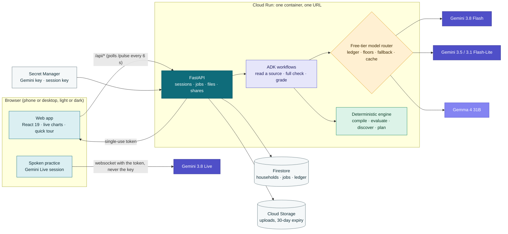
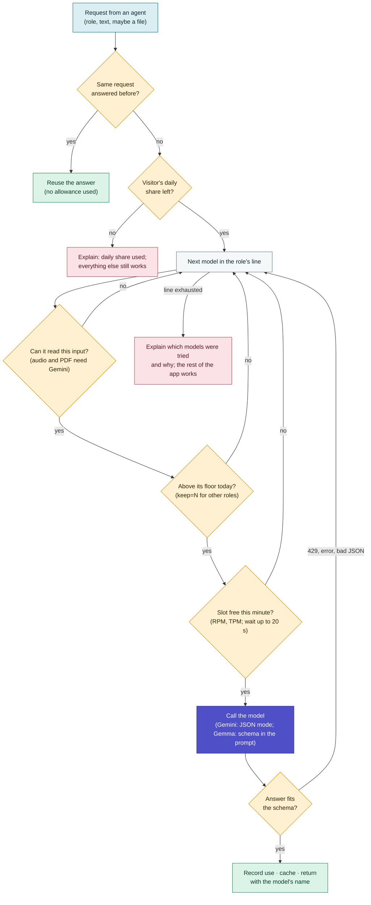

# Architecture

If I Disappear has one rule that shapes everything else: **the AI reads, code decides.**
Gemini turns voice notes, photos and documents into small facts ("claims"), each with the
exact words it came from. People accept or reject them. A deterministic engine then works out,
day by day, what will and won't get done while someone is away, finds what nobody said, and
plans the smallest set of steps that fixes the most. Every number a person sees comes from that
engine, never from a model. And the AI runs on the **free Gemini tier**, through a router that
keeps every model inside its own limits.

## The system in one picture



The web app and the API ship as **one container** on Cloud Run. Firebase Hosting can sit in
front instead (see `firebase.json`); nothing else changes.

## The loop

| Step | Screen | Who does the work |
|---|---|---|
| 1. Talk, photograph, upload or type; or add a task with a short form | Capture | Person; redaction by code; voice converted to 16 kHz WAV in the browser |
| 2. Listen or read, then extract facts with verbatim quotes | Capture (progress) | Gemini or Gemma through the router, inside an ADK workflow |
| 3. Check every quote against the stored text | Review facts | Code |
| 4. Accept, edit or reject each fact | Review facts | Person |
| 5. Compile accepted facts into a model of the household | (all) | Code |
| 6. Walk through every date of the absence | Overview, Calendar | Code (the engine) |
| 7. Find what nobody said | What we found | Code (discovery) |
| 8. Review each finding: uphold, narrow or ask | What we found | Gemini (the challenger), checked by code |
| 9. Try "what if": someone else away, a thing missing, a longer absence | Explore | Code only, on a copy; nothing saved |
| 10. Plan the fewest steps within the time you have | Plan | Code (optimiser) |
| 11. Record that a step is done (agreement, photo, practice) | Plan | Person; the same effects the planner used |
| 12. Practise: explain the task back, by voice or typing | Practise, handover link | Gemini Live partner; grade decided by code |
| 13. One printable page for the fridge; a private link per person | Card, Share | Code |

After steps 4, 9 and 11 the engine recomputes everything at once (no model call), and every
open screen updates by itself within a few seconds.

## The engine (`services/api/app/engine`)

### What it models

- **Responsibilities**: what has to keep happening, with a recurrence (once, daily, weekly,
  monthly, yearly, ongoing; interval, weekdays, day of month, anchor date), an importance from
  1 to 3, the people who do it today, and how people find out when it's due (the bill, an SMS,
  the clinic book).
- **Routes**: complete ways of doing a responsibility. A route works only if *all* its
  requirements hold: access to resources, a permit still valid, a fact that is true, a free
  time window, and a willing person. A responsibility works if *any* route works.
- **Resources**: phone numbers, handsets, contacts, documents, places, accounts, vehicles,
  permits, services, notes and items. Each can have a holder, people it is shared with,
  containers it is stored on (a contact on a phone, a book in a drawer), prerequisites (an
  e-wallet needs a one-time code sent to a number), an expiry date and a renewal task.
- **People and time**: roles, children (never assigned tasks), recurring commitments (shifts,
  airport runs) that are movable or booked, and days someone is unavailable.
- **Facts**: conditions that are true, false or unknown, optionally with a known way to make
  them true.
- **Handover evidence**: what each person has seen, explained back or shown, and what's on the
  Continuity Card.

### How it decides

For every date a responsibility is due during the absence, and for every route and every
person who could do it, the engine evaluates the requirements in **three-valued logic** (true,
false, unknown): a missing fact is *unknown*, not *false*. Windows are half-open time
intervals; a commitment that overlaps the route's window blocks that person on that day.
Access follows holders, shares, containers and prerequisites, and names the real gap ("Mr
Silva's number is only on Nirmala's phone, and Nirmala is away"). Permits are projected
forward: a renewal nobody at home is ready to do makes everything that needs the permit fail
after the expiry date.

A date that *works* is not yet *prepared*. Each responsibility has an evidence policy set by
its importance: **light** (willing and has seen the steps), **standard** (has explained it back
without help) or **critical** (has also shown the key step). Knowing *when* it's due counts
too: someone who doesn't get the reminder needs it on the Continuity Card.

Each responsibility ends in one of five states: **ready**, **handover not finished**, **needs a
check**, **blocked**, or **nothing due while away**. The headline names the date that explains
the state and the reason, so a person can act on it.

### What it finds (`discover.py`)

| Finding | How code finds it |
|---|---|
| Still needed while away | A resource next to several responsibilities is only a candidate. The engine re-runs the absence as if the resource were still available to everyone at home (a **knockout**) and keeps only the links where that changes the outcome, or where it's the only reminder. Links set aside are shown, with the reason. |
| Held by the person leaving | For every date that isn't ready, what the people who could step in would hit on each route. A held item is reported only when no route that avoids it could work. |
| Clash | A person's commitment overlaps the window a task needs, on the dates it fails. |
| Deadline while away, or before leaving | A permit expires during the absence (or before departure), the renewal isn't ready, and what that blocks from which date. |
| Not asked | Someone is the only option but nobody has asked them. |
| Sources disagree | The same amount or date is stated differently in two sources. |

The AI challenger then reviews each finding: uphold, narrow (drop a responsibility, citing the
finding's own facts) or turn it into a question. Code rejects anything it cites that isn't in
the finding; it can't add a finding or change a number.

### How it plans (`repair.py`)

For every date that isn't ready, the planner works out the steps that would make one person's
route work and meet the evidence policy. Steps are typed and carry **effects**: `ASK`,
`ASK_SWAP` (free a commitment on specific dates), `SHARE_CONTACT`, `SHARE_LOCATION`,
`LEAVE_WITH`, `SEND_COPY`, `SETUP_ACCESS`, `KEEP_ACTIVE`, `CONFIRM`, `REGISTER`, `RENEW_EARLY`,
`ADD_TO_CARD`, `VIEW`, `PRACTICE`, `DEMONSTRATE`.

Steps are grouped into bundles (one per responsibility and person; swaps for the same
commitment become one conversation). The optimiser searches every combination of bundles that
fits the time budget (exhaustively up to 12 bundles, otherwise the two most promising per
responsibility) and picks the best occurrence coverage, then weighted readiness, then the
lightest load on the busiest person, then the fewest minutes. Ties break the same way every
time.

A plan is hypothetical. Nothing changes until someone records that a step is done; that
evidence applies **the same typed effects** to the household's real model, as one new source
with one fact per effect. That's why "the plan says 6 of 7" and "after the handover, 6 of 7
are ready" can be compared.

### Explore (`services/explore.py`)

What-if questions run the same engine on a **copy** of the scenario: someone else away too, a
resource unavailable (a phone, a document, an app), an assumption the family made undone, a
different length of absence. The result lists what would change, better or worse, and the
before/after counts. Nothing is saved and no model is called, so it answers instantly.

### Determinism

The compiler puts entities and claims in a canonical order, so the same accepted facts give the
same answer in whatever order they were captured. The evaluation harness checks this with
shuffled inputs and fresh Python processes using different hash seeds.

## The AI layer (`services/api/app/workflows`, `app/ai`)

### Workflows

All model calls run inside **Google ADK workflows** (graphs of code nodes and agent nodes with
structured output):

```text
ingest:   START → route_source ─listen→ listener (agent) → after_listen ─┐
                               ─read──→ reader (agent)   → after_read  ──┼→ extractor (agent) → verify_and_resolve
                               ─text──→ text_ready ──────────────────────┘
analysis: START → compile_claims → evaluate_scenario → discover_findings
                  ─findings→ build_challenge → challenger (agent) → apply_challenge → plan_preparation
                  ─none────→ plan_preparation
grade:    START → build_prompt → grader (agent) → decide_result
```

| Agent (role) | Output schema | Guarded by code |
|---|---|---|
| listener (voice notes) | `Transcript` | redaction before storing |
| reader (photos, PDFs) | `Reading` | redaction, sample detection |
| extractor | `Extraction` (entities, claims, quotes, questions) | quote check, entity resolution, secrets, required fields, the review gate |
| challenger | `ChallengeReport` | citations must be the finding's own facts; can't add or renumber |
| grader | `PracticeGrade` | a step counts only with a quote of the learner's own words; the result is decided by code |
| practice partner | audio + transcripts (Gemini 3.8 Live) | single-use token with the instructions locked in |

Source text reaches the models fenced as data (`<<<SOURCE … SOURCE>>>`), and every prompt
says so. Prompts live in `app/ai/prompts/*.md`.

### The free-tier model router (`app/ai/router.py`, `app/ai/quota.py`)

Each agent is a `RoutedGemini` model (a subclass of ADK's `Gemini` model) with a **role**. Every
request goes through `route_call`:



The ledger counts requests per minute, tokens per minute and requests per day for each model
(days reset at midnight Pacific time, as Google's do), keeps a 5% reserve, records 429s as
cool-downs, and is saved to the store once a minute so restarts don't forget. Lines, floors and
limits are settings; see [FREE_TIER.md](FREE_TIER.md).

**Two modes, same graphs.** With a Gemini key the agents call Google. Without one, a
`ReplayLlm` (a subclass of ADK's `BaseLlm`) answers from reviewed sample data, a rule-based
reviewer and a keyword grader, and the interface says "Offline demo". Unknown sources can't be
read offline, and the app says so instead of pretending. If ADK or a model fails mid-analysis,
the same deterministic steps run as a plain state machine and the trace records the fallback.

**Spoken practice.** The browser asks the API for an ephemeral Gemini Live token that can open
one session within two minutes, lasts 30 minutes, and has the model, the partner's instructions
and transcription locked in. The browser talks to Gemini directly for low latency and sends the
transcripts back for grading. The API key never leaves the server.

## Data and storage

- **One Firestore document per household** (`households/{id}`): owner, the household's
  knowledge (settings, entities, sources, claims with review state, procedures, handover
  events, practice attempts), the latest analysis snapshot, a readiness **history** (for the
  trend chart), **share links** (only SHA-256 fingerprints of the tokens), and an activity log.
  Writes use a transaction with a revision number; a size guard keeps documents under 1 MiB;
  a household holds at most 40 sources.
- **Jobs** (`jobs/{id}`): reading, extraction and the full check run as background jobs the
  browser polls, so long model calls never hit a request timeout. Cloud Run keeps CPU allocated
  so jobs finish.
- **Meta** (`meta/quota`): today's free-tier ledger.
- **Uploads**: a private Cloud Storage bucket with uniform access and public access prevention;
  a lifecycle rule deletes files after 30 days. Locally, files go to `services/api/.data`.
- **Clients never touch the database or bucket**: security rules deny everything; the API
  checks ownership on every request.

## Who is calling (`app/auth.py`)

| `AUTH_MODE` | Use | How |
|---|---|---|
| `session` | Default for a deployment | `POST /api/session` returns an HMAC-SHA256-signed visitor id (30 days). No sign-in screen between a judge and the demo. |
| `firebase` | Households that follow a person across devices | Firebase Auth anonymous sign-in; ID tokens verified with the Admin SDK. |
| `dev` | Local development only | `X-Dev-User` header. |

Every visitor gets their **own copy** of each sample household. The person staying opens a
**handover link** without any session: the token travels in the URL fragment (never in server
logs or referrers) and in request bodies.

## API

```text
GET  /api/health  /api/config  /api/evals  /api/demos  /api/samples  /api/samples/{hh}/{file}   public
GET  /api/ai/usage                                                   today's allowance per model (live meter)
POST /api/session                                                    signed visitor session
POST /api/demo  {household?, reset?}   /api/demo/{id}/stage | /variant   sample households
POST /api/households                   GET /api/households           start your own; list yours
GET  /api/households/{id}  /pulse  /export  /card  /explore  /shares
PATCH /api/households/{id}/settings    DELETE /api/households/{id}
POST /api/households/{id}/people  /responsibilities  /scope
POST /api/households/{id}/sources  (+ /{sid}/extract, DELETE, GET /{sid}/file)      capture (job)
POST /api/households/{id}/claims/{cid}  /claims-accept-verified                     review
POST /api/households/{id}/analyze                                                   full check with AI review (job)
POST /api/households/{id}/plan  /explore  /evidence  /findings/{fid}/answer
GET|PUT /api/households/{id}/procedures/{rid}                                       draft and approve steps
GET  /api/households/{id}/practice/{rid}   POST …/token   POST …/attempts           practise and grade
POST /api/households/{id}/shares       DELETE /api/households/{id}/shares/{sid}      handover links
POST /api/handover/open  /practice  /voice                                          the person staying (token only)
GET  /api/jobs/{job_id}                                                             job progress and trace
```

Interactive documentation is served at `/api/docs`.

## The web app (`apps/web`)

React 19, TypeScript, Vite 7 and React Router 7, English only. No chart library: every chart is
a small accessible SVG component (`components/charts`). Fonts are bundled (Bricolage Grotesque
for headings and numbers, Figtree for text), so there are no third-party requests and the
strict Content Security Policy holds.

| Part | Where |
|---|---|
| Design tokens: two themes (light and dark) plus "same as this device"; five state colours, each paired with an icon and a word | `styles/tokens.css`, `lib/theme.ts`, `public/theme-init.js` (sets the theme before first paint) |
| Shell: glass sidebar with a coloured active pill, top bar with the live AI pill and activity bell, drawer and bottom bar on phones | `components/shell` |
| Live updates: `/pulse` every 6 s (refreshes the household when its revision changes), `/ai/usage` every 10 s, both paused when the tab is hidden | `state/app.tsx`, `lib/hooks.ts` |
| Charts: week bars with a dark tooltip and keyboard control, donut with legend, trend with the plan's projection, calendar month, sparklines and rings | `components/charts` |
| Quick tour: 12 spotlight steps across the pages, keyboard and phone friendly, offered on the first visit | `components/tour/Tour.tsx` |
| The boarding pass (the absence as a ticket) and reeded glass for what only the person leaving holds | `components/household.tsx`, `pages/Findings.tsx` |
| Voice capture: MediaRecorder with a level meter, converted to 16 kHz mono WAV before upload | `lib/recorder.ts` |

Screens: Landing, Start, Overview, What we found, Explore, Calendar, Plan, Practise, Card,
Capture, Review facts, Share, Household, How it was worked out, Evaluation, and the handover
page for the person staying. `scripts/smoke.mjs` walks through 22 flows in Chromium;
`scripts/screenshots.mjs` captures every screen in both themes on desktop and phone.

## Repository map

```text
apps/web/                 the web app (pages, components, charts, tour, styles, scripts)
services/api/app/
  engine/                 model, evaluate, discover, repair, effects, serialize, time
  domain/                 claims (the reviewable knowledge base), compile, households
  ai/                     router, quota ledger, prompts, schemas, redaction, replay model, Live tokens, grading
  workflows/              ADK graphs: ingest, analysis, practice
  services/               households, jobs, evidence, explore, manual entry, shares, procedures, card, views
  store/                  memory and Firestore stores, local and GCS blobs
  routes/                 the HTTP API
  verify/                 quote verification, gold comparison
services/api/fixtures/    four synthetic households with sources, claims and gold answers
services/api/tests/       unit and end-to-end tests (98)
evals/                    the evaluation harness and its generated report
infra/                    Cloud Build, setup and deploy scripts, security rules
docs/                     this file and the rest of the documentation
```
